

  

  
   Скачивается сразу ZIP с последней версией · <a href="https://github.com/NikoliniOFF/IslandDesk/releases">Все версии</a>

  
  
  

<h1 align="center">IslandDesk для Windows</h1>

  <b>«Динамический остров», как на iPhone, — вверху экрана Windows.</b> 
  Чёрная пилюля сама показывает, что происходит: музыку, громкость, таймер, загрузки и уведомления — и плавно перетекает из формы в форму. А в спокойные минуты — время, погоду и ближайшее событие календаря. 
  Бесплатно · без Pro-версии · без рекламы и слежки · около 1 МБ · обновляется сама.

  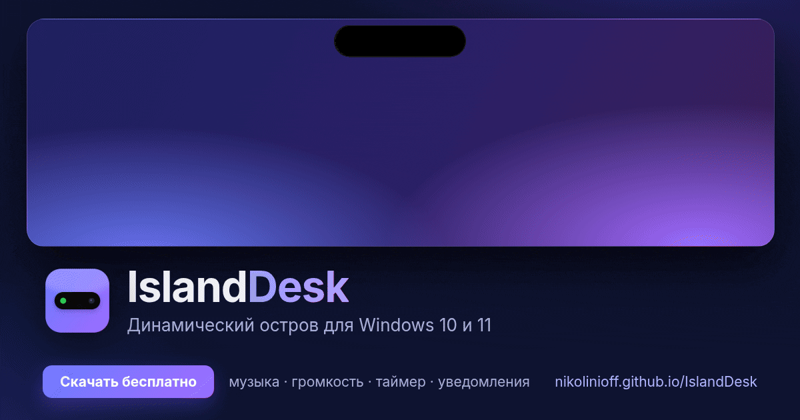

---

## 🆕 Новое в 1.4

**1.4.1:** своё сочетание для выбора из буфера (щёлкните и нажмите клавиши) и, по желанию, **Win+V** вместо журнала Windows. История буфера до 200 записей, окно выбора больше, с 2–3 строками на запись. Картинки хранятся сжатыми. По желанию история сохраняется между запусками в зашифрованном файле. Погода и курсы ЦБ показывают, когда обновились, и сразу обновляются при смене даты. [Что нового в 1.4.1 →](https://github.com/NikoliniOFF/IslandDesk/releases/tag/v1.4.1)

  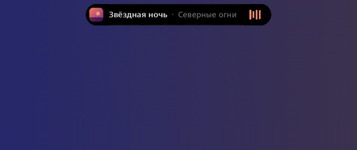

Выбор из буфера по **Win+Shift+V**, как Win+V в Windows: список у курсора, поиск набором, Enter, и выбранное сразу вставляется. Копирование ячейки из **Excel в 1С** без невидимого символа в конце. Плеер заполняет остров, а в свёрнутой пилюле посередине название (или строка песни). Короткие уведомления выровнены по одной сетке. Новые анимации, у каждой свой переключатель. По желанию: прогноз на неделю и ещё города, звонки в Discord, Telegram, Teams и Яндексе, картинки в буфере, установка игр Epic, выбор плеера. [Что нового в 1.4.0 →](https://github.com/NikoliniOFF/IslandDesk/releases/tag/v1.4.0)

  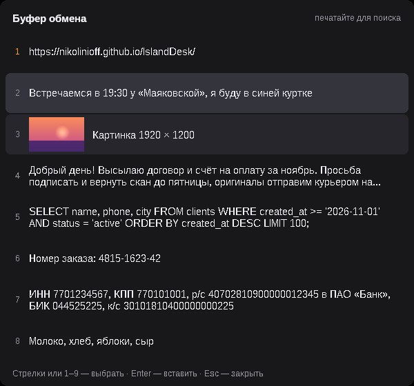

В 1.3: снимок SnapDesk миниатюрой, прогноз по часам и «скоро дождь», несколько календарей, напоминания одной фразой, вставка без форматирования, камера и загрузки Steam. [Что нового в 1.3.0 →](https://github.com/NikoliniOFF/IslandDesk/releases/tag/v1.3.0)

В 1.2: часы, погода, событие календаря и заряд в пилюле, домашний экран с карточками и «красивые анимации». [Что нового в 1.2.0 →](https://github.com/NikoliniOFF/IslandDesk/releases/tag/v1.2.0)

## ✨ Что умеет

| | |
|---|---|
| 🕒 **Часы в пилюле** | Когда ничего не происходит, в пилюле время в формате Windows, а при наведении — дата. Рядом 1–2 значка: погода, ближайшее событие, заряд батареи или наушников, курсы ЦБ или «до Нового года N дней»; их можно сменять по кругу. |
| 🌤️ **Погода** | Выберите город поиском в настройках — значок и температура обновляются раз в 45 минут через Open-Meteo. Без ключей и без определения места по IP. |
| 📅 **Календарь** | Ближайшее событие («Планёрка через 15 мин») из ссылок или файлов .ics — Google, Яндекс, Outlook — и напоминание за 10 минут. Календарей может быть несколько: у каждого имя, цвет и свой переключатель. |
| 🌧️ **Прогноз и дождь** | На «главной» — пять ближайших часов, а если включить — и неделя вперёд и ещё до трёх городов. Если дождь или снег вот-вот начнётся, остров предупредит примерно за полчаса. |
| 📝 **Напоминания одной фразой** | «через 25 минут вынуть пирог», «завтра в 9 позвонить маме», «каждый день в 13:00 обед», «по будням в 9:45 планёрка» — правый щелчок по острову → «Напомнить…». До трёх часов — таймер с подписью прямо на острове. |
| 🖼️ **Снимки и клипы** | Снимок SnapDesk появляется миниатюрой — утащите её мышью в чат или письмо, щелчок откроет. По желанию так же — новые клипы игр (NVIDIA, Xbox Game Bar) из папки «Видео». |
| 🎮 **Камера, звонки и игры** | Зелёная точка, пока программа снимает камерой. Если включить «Звонки» — «Telegram · 12 мин», пока идёт звонок в Discord, Telegram, Teams, Яндекс Мессенджере или Телемосте. Пока Steam качает игру — название и проценты, Epic Games ставит — название; в конце «готово». |
| 🏠 **Домашний экран** | Щелчок по спокойной пилюле — крупные часы, карточки погоды, события и курсов, нагрузка процессора, памяти и сети (считается, только пока остров открыт) и быстрые таймеры. |
| ✨ **Красивые анимации** | Пружинистое раскрытие, капля, которая отделяется от острова и сливается обратно, волна по краю при уведомлении, «дышащая» под музыку пилюля. Если в Windows анимации выключены, IslandDesk тоже без них. |
| 🎵 **Сейчас играет** | Spotify, Яндекс Музыка, YouTube в браузере и другие плееры, которые показывают музыку в Windows: обложка, название, исполнитель и кнопки; полосу трека можно тянуть, если плеер разрешает перемотку. Пока звук играет — пляшет эквалайзер. Щелчок по острову — большой плеер. |
| 🔊 **Громкость и яркость** | Аккуратная полоска вместо системного окошка, видно, на какое устройство идёт звук. Колесо мыши над островом меняет громкость. Яркость — на встроенных экранах ноутбуков. |
| ⌨️ **Раскладка и Caps Lock** | RU / EN при переключении, Caps Lock и Num Lock — вкл / выкл. |
| 🎧 **Наушники и батарея** | Подключение и отключение наушников, заряд Bluetooth-наушников, «Зарядка», «Работа от батареи» и «Низкий заряд» на ноутбуке. |
| ⏱️ **Таймер** | Всегда под рукой: вкладка «Таймер» в раскрытом острове (даже когда играет музыка или занят микрофон) или правый щелчок по острову либо по значку у часов → «Запустить таймер». 1, 5, 10, 25 минут или свой (колесо мыши меняет его длительность). Пока таймер идёт, на острове кольцо и время; в конце — «Время вышло» со звуком. |
| 🗂️ **Вкладки** | В раскрытом острове сверху ряд: Музыка, Таймер, Загрузка, Микрофон, Буфер, Полка. Таймер есть всегда, остальное — когда есть что показать. Выбранная вкладка не перебивается, а пока курсор над островом, он не сворачивается. |
| 📋 **Буфер обмена** | Скопировали — остров коротко покажет, что именно: текст, картинку или файлы. Во вкладке «Буфер» последние записи (история хранит 25–200, по умолчанию 50, закреплённые сверх этого), щелчок копирует снова; булавка закрепляет строку, «Найти» ищет по истории, а Ctrl+Shift+V (если включить) вставляет без форматирования. **Win+Shift+V** (или своё сочетание, или по желанию сам **Win+V**) открывает список у курсора, как Win+V в Windows: набор текста ищет, Enter или цифра вставляет. Окно компактное, большое или очень большое. Ячейка из Excel копируется без лишнего перевода строки в конце (для 1С). По желанию — до 12 картинок, сжатых без потерь. Сразу история только в памяти и при выходе забывается; если включить «Хранить историю между запусками», она лежит в зашифрованном файле в %LOCALAPPDATA%\IslandDesk (выключили — файл удалён). То, что менеджеры паролей помечают как секретное, не читается. Буфер и подсказку можно выключить по отдельности. |
| 📥 **Полка файлов** | Бросьте файлы на остров — они полежат на полке (до 12). С полки файл можно утащить в любое окно, открыть, показать в папке или убрать. Хранятся ссылки на файлы, а не копии; при выходе полка очищается. |
| ⬇️ **Загрузки** | Пока браузер качает файл — «Идёт загрузка», потом «Скачано» с кнопками «Открыть» и «Показать в папке». Папку можно сменить. |
| 🎙️ **Микрофон** | Оранжевая точка, пока Discord, Zoom или другая программа слушает микрофон; выключить микрофон — в один щелчок. |
| 🔔 **Уведомления программ Nikolini** | PeekDesk, SnapDesk и другие программы Nikolini могут показать на острове короткое сообщение. А если стоит [PeekDesk](https://nikolinioff.github.io/PeekDesk/), файл, брошенный на правую половину острова, откроется в нём (левая — полка). |
| 🪄 **Виды пилюли** | По желанию: «чёлка» у края экрана, спрятанная пилюля выезжает, если подвести мышь к верхнему краю, остров прячется в выбранных программах, щелчки проходят сквозь него, он не попадает в скриншоты и запись экрана (Windows 10 2004+). А ещё — секунды, процессор в пилюле, номер рабочего стола, текст песни, эквалайзер по краю и новогодний снег. |
| 🫧 **Живой и тактичный** | Форма меняется пружинами с частотой вашего монитора; второе занятие (например, музыка при идущем таймере) — кружок рядом. Остров не забирает фокус, не мешает щелчкам рядом и прячется в играх, фильмах и презентациях. |
| 🪶 **Лёгкий** | exe около 1,4 МБ, без установщика. В простое IslandDesk ничего не опрашивает и почти не тратит процессор: просыпается по событиям Windows, а с часами — ещё раз в минуту, чтобы сменить цифры. |
| ⚙️ **Всё выключается** | У каждой функции свой переключатель. Можно прятать пилюлю, когда ничего не происходит, выбрать монитор и размер острова (90–130 %). |

## 📸 Как это выглядит

  
  
  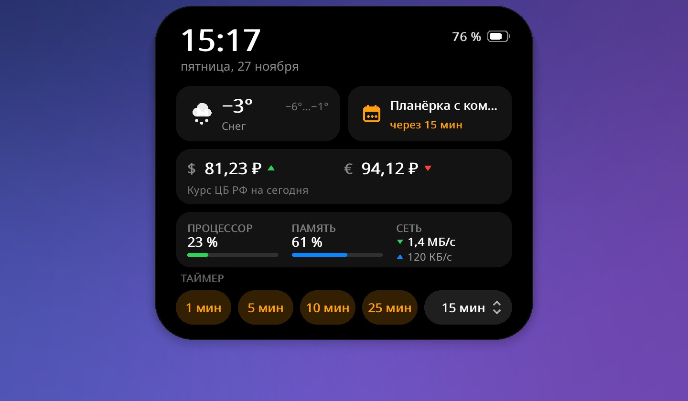
  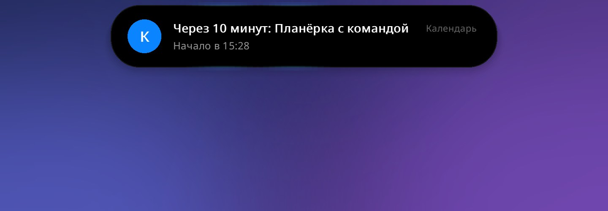
  
  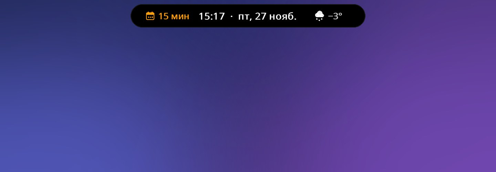
  
  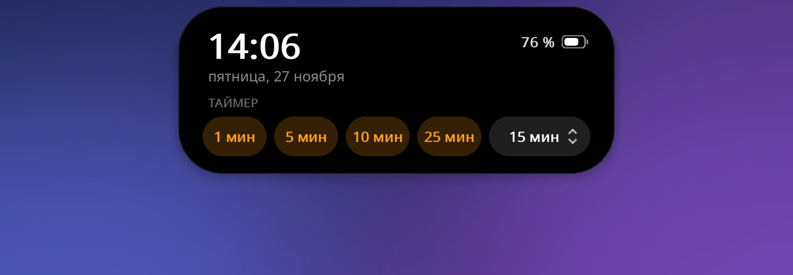
  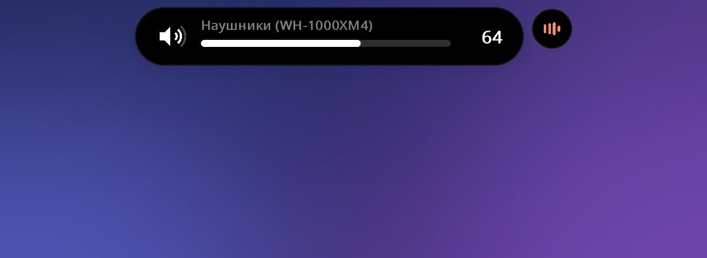
  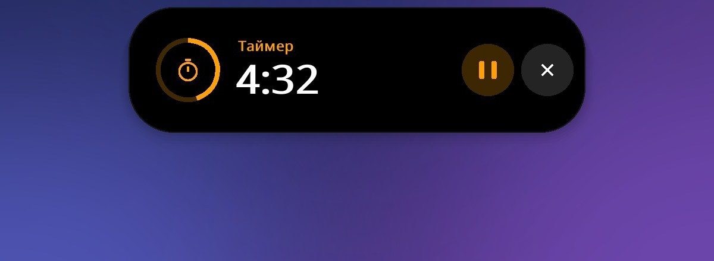
  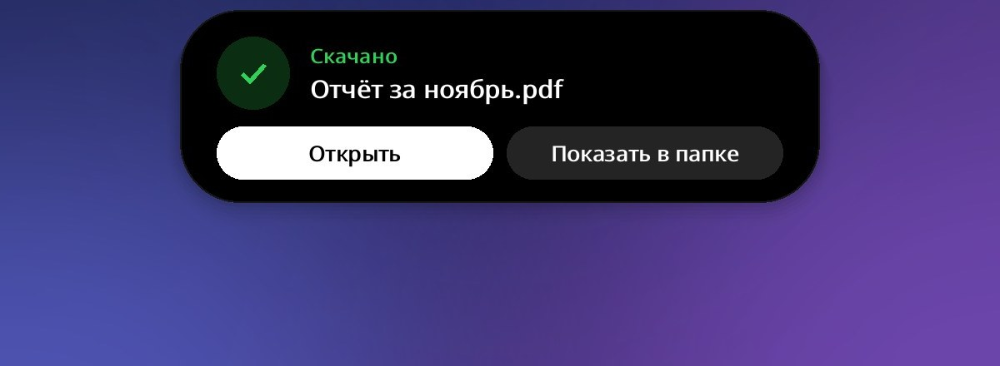
  
  
  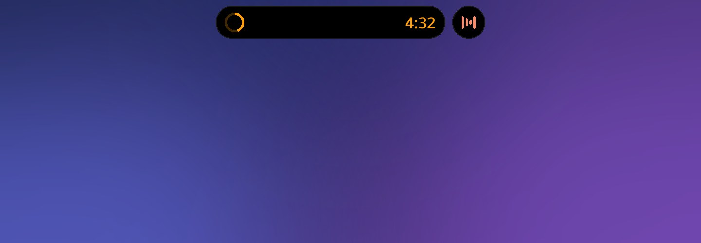
  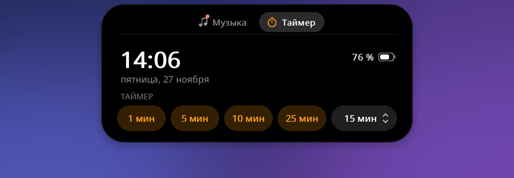
  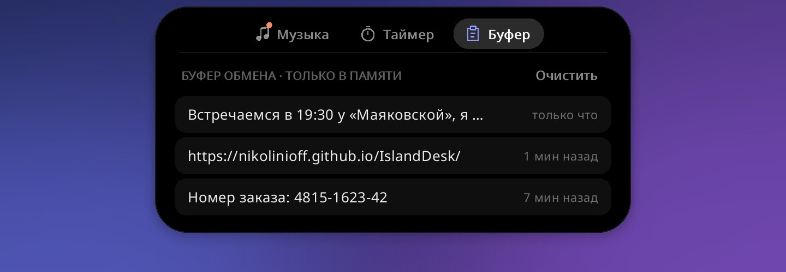
  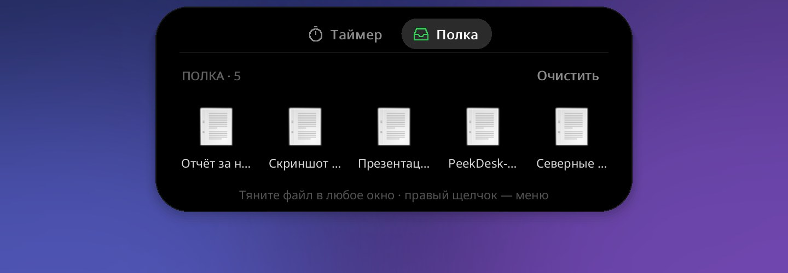
  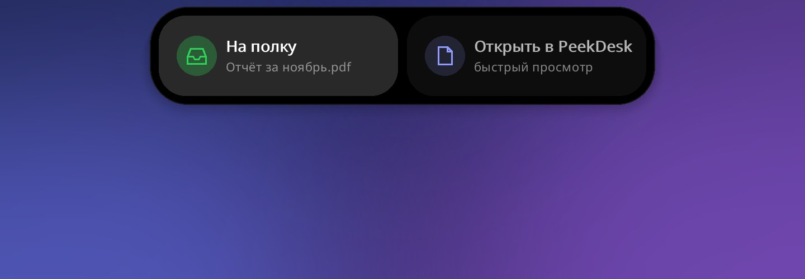

  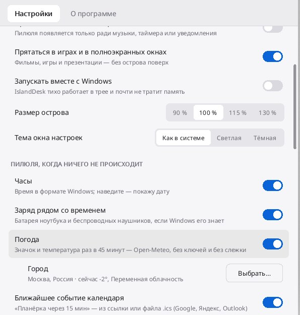
  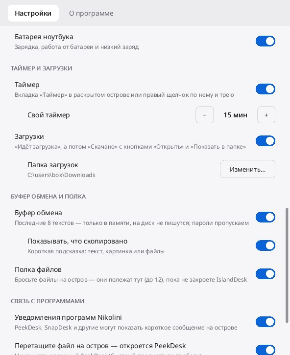
  
  

## 📥 Как установить

1. Скачайте [**IslandDesk-win64.zip**](https://github.com/NikoliniOFF/IslandDesk/releases/latest/download/IslandDesk-win64.zip).
2. Распакуйте в постоянную папку, например `Документы\IslandDesk`.
3. Запустите **IslandDesk.exe** — остров появится вверху экрана, значок — у часов.
4. Если Windows покажет «Система Windows защитила ваш компьютер» — «Подробнее» → «Выполнить в любом случае».

**Требования:** Windows 10 (1809 или новее) или 11, 64-бит.

## ⚙️ Настройки

Щёлкните по значку IslandDesk у часов (или запустите `IslandDesk.exe` ещё раз) — откроется окно настроек. Там можно выключить любую функцию, выбрать монитор, размер острова и тему окна, город для погоды, календарь .ics, папку загрузок и длительность своего таймера, режим обновлений: «Автоматически», «Спрашивать» или «Не проверять». Вкладка «О программе» — версия, «Что нового» и проверка обновлений.

Настройки хранятся в `%APPDATA%\IslandDesk\settings.ini`. Правый щелчок по острову или по значку у часов — меню с пунктом «Запустить таймер».

## ❓ Вопросы

Почему SmartScreen предупреждает?

Программа новая и пока не подписана платным сертификатом. Скачивайте IslandDesk только со страницы выпусков на GitHub — рядом с архивом лежит файл `.sha256` с контрольной суммой.

Не будет ли тормозить компьютер?

Нет. В простое IslandDesk ничего не опрашивает: остров перерисовывается, только когда что-то изменилось (с часами — раз в минуту), а анимация идёт лишь во время смены формы. Нагрузка процессора и сети считается, только пока открыт домашний экран. Эквалайзер работает, только пока играет музыка; таймер обновляется раз в секунду, только пока идёт.

Какие плееры показываются?

Все, что сообщают Windows о музыке (те же, что видны в системной плашке громкости): Spotify, Яндекс Музыка, браузеры (YouTube, ВК Музыка и др.), «Медиаплеер» Windows и другие.

Остров закрывает часть окна?

Он маленький и сидит у самого верхнего края. Щелчки рядом с пилюлей проходят в окно под ней. В полноэкранных играх и видео остров прячется сам, а в настройках можно прятать его, когда ничего не происходит.

Почему календарь через .ics, а не сразу «Календарь» Windows?

Календарь Windows отдаёт события только программам из Microsoft Store с особым «паспортом» пакета, а IslandDesk — обычный exe без установщика. Поэтому он читает календарь по ссылке .ics: в Google это «Секретный адрес в формате iCal», в Яндексе — «Экспорт» → ссылка, в Outlook — «Опубликовать календарь» → ICS. Подойдёт и файл .ics на диске. Ссылка хранится только в `settings.ini`.

Почему не меняется яркость внешнего монитора?

Пока яркость показывается только для встроенных экранов ноутбуков (то, чем управляет сама Windows). Внешние мониторы по DDC/CI пока не поддерживаются.

Буфер обмена где-то сохраняется?

Сразу нет: история живёт только в памяти IslandDesk и пропадает при выходе или выключении функции; в интернет она не попадает никогда. Если включить «Хранить историю между запусками», она сохраняется в один файл в %LOCALAPPDATA%\IslandDesk, зашифрованный средствами Windows (DPAPI): прочитать его можно только под вашей учётной записью. Выключите переключатель, и файл удалится. Содержимое, которое программы помечают как секретное (так делают менеджеры паролей), IslandDesk не читает. Файлы из буфера только коротко показываются, а картинки запоминаются, только если включить «Картинки в истории».

Почему перемотка работает не во всех плеерах?

IslandDesk перематывает через Windows, и плеер сам решает, разрешать ли это. Если плеер перемотку не даёт, полоса трека просто не реагирует на щелчки.

Программа что-нибудь отправляет?

Нет. IslandDesk ничего не собирает. В интернет он обращается к GitHub — вскоре после запуска и раз в 12 часов, чтобы узнать, не вышла ли новая версия (это можно выключить), а при открытии настроек обновляет список «Другие программы от Nikolini». Если вы включили погоду, курсы, календари по ссылке или текст песни — ещё к Open-Meteo (координаты выбранного города), cbr-xml-daily.ru (курсы ЦБ РФ), к адресам ваших календарей и к lrclib.net (исполнитель и название трека). Без этих функций туда ничего не уходит.

## 🧩 Другие программы от Nikolini

<table>
  <tr>
    <td width="96" align="center"></td>
    <td>
      <b><a href="https://nikolinioff.github.io/HubDesk/">HubDesk</a></b> — все программы Nikolini в одном окне: установка, включение, автозапуск и обновления галочками. 
      <a href="https://nikolinioff.github.io/HubDesk/">Сайт</a> · <a href="https://github.com/NikoliniOFF/HubDesk">GitHub</a>
    </td>
  </tr>
  <tr>
    <td width="96" align="center"></td>
    <td>
      <b><a href="https://nikolinioff.github.io/WinterDesk/">WinterDesk</a></b> — снег на рабочем столе Windows: сугробы на окнах, гирлянды, ёлочка и отсчёт до Нового года. 
      <a href="https://nikolinioff.github.io/WinterDesk/">Сайт</a> · <a href="https://github.com/NikoliniOFF/WinterDesk">GitHub</a>
    </td>
  </tr>
  <tr>
    <td width="96" align="center"></td>
    <td>
      <b><a href="https://nikolinioff.github.io/PeekDesk/">PeekDesk</a></b> — предпросмотр файлов по пробелу в Проводнике Windows, как Quick Look в macOS. 
      <a href="https://nikolinioff.github.io/PeekDesk/">Сайт</a> · <a href="https://github.com/NikoliniOFF/PeekDesk">GitHub</a>
    </td>
  </tr>
  <tr>
    <td width="96" align="center"></td>
    <td>
      <b><a href="https://nikolinioff.github.io/SnapDesk/">SnapDesk</a></b> — скриншоты и запись экрана по горячей клавише, как в macOS: миниатюра в углу, которую можно перетащить в Discord. 
      <a href="https://nikolinioff.github.io/SnapDesk/">Сайт</a> · <a href="https://github.com/NikoliniOFF/SnapDesk">GitHub</a>
    </td>
  </tr>
  <tr>
    <td width="96" align="center"></td>
    <td>
      <b><a href="https://nikolinioff.github.io/DockDesk/">DockDesk</a></b> — док для Windows, как в macOS: любимые программы внизу экрана, значки плавно растут под курсором. 
      <a href="https://nikolinioff.github.io/DockDesk/">Сайт</a> · <a href="https://github.com/NikoliniOFF/DockDesk">GitHub</a>
    </td>
  </tr>
  <tr>
    <td width="96" align="center"><a href="https://nikolinioff.github.io/SpotDesk/">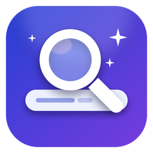</a></td>
    <td>
      <b><a href="https://nikolinioff.github.io/SpotDesk/">SpotDesk</a></b> — быстрый поиск по Alt+Space в Windows, как Spotlight в macOS: программы, файлы, калькулятор и курсы валют. 
      <a href="https://nikolinioff.github.io/SpotDesk/">Сайт</a> · <a href="https://github.com/NikoliniOFF/SpotDesk">GitHub</a>
    </td>
  </tr>
  <!-- Новая программа: скопируйте строку <tr>…</tr> выше и поменяйте значок, название, описание и ссылки. -->
</table>

Все программы — на [github.com/NikoliniOFF](https://github.com/NikoliniOFF).

## 💬 Обсуждение

- 💡 [Предложить идею](https://github.com/NikoliniOFF/IslandDesk/discussions/new/choose)
- 🐞 [Сообщить о баге](https://github.com/NikoliniOFF/IslandDesk/issues/new?template=bug.yml)
- 💬 [Все обсуждения](https://github.com/NikoliniOFF/IslandDesk/discussions)

---

IslandDesk · автор — <a href="https://github.com/NikoliniOFF">Nikolini (NikoliniOFF)</a> · бесплатно, без рекламы и без слежки

