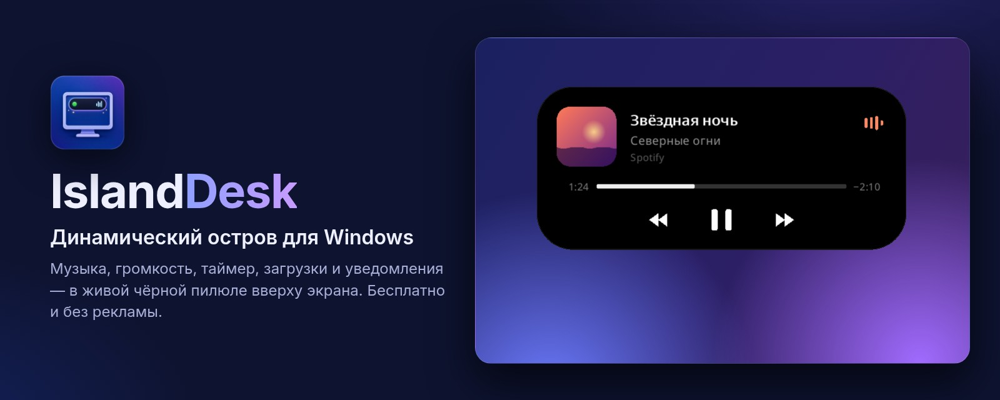
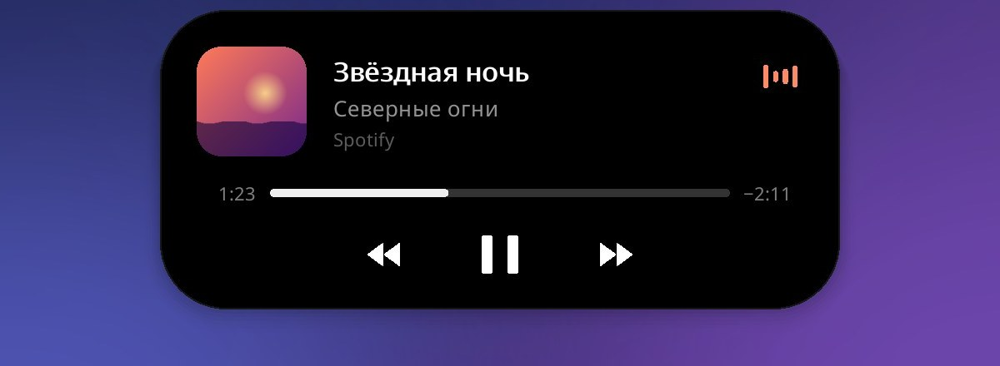
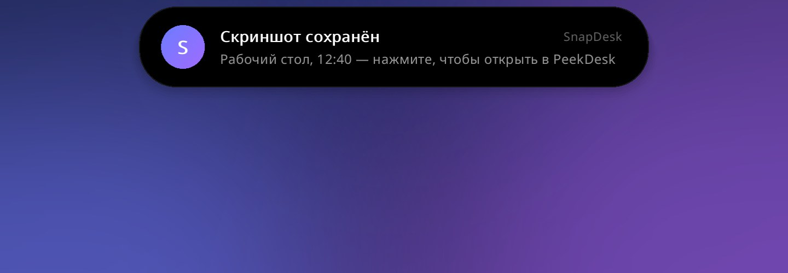
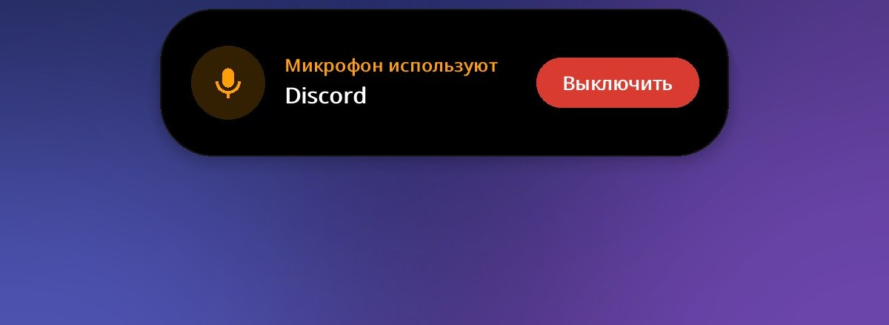
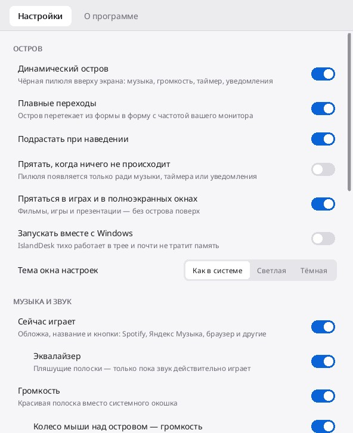
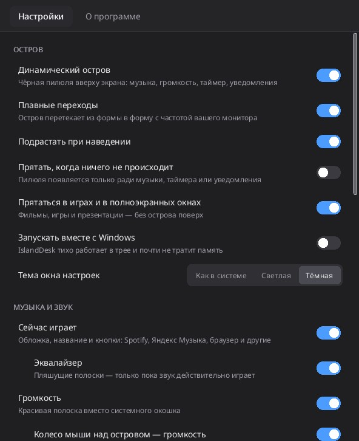
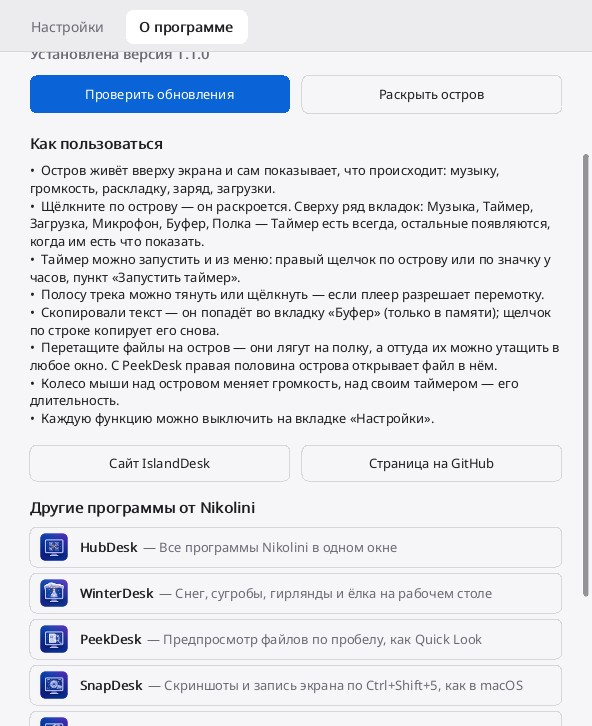
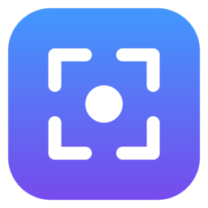
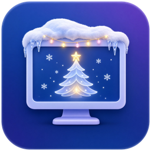
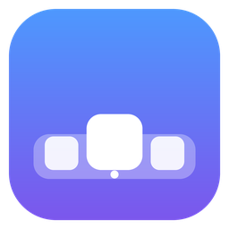

  

  
   Скачивается сразу ZIP с последней версией · <a href="https://github.com/NikoliniOFF/IslandDesk/releases">Все версии</a>

  
  
  

<h1 align="center">IslandDesk для Windows</h1>

  <b>«Динамический остров», как на iPhone, — вверху экрана Windows.</b> 
  Чёрная пилюля сама показывает, что происходит: музыку, громкость, таймер, загрузки и уведомления — и плавно перетекает из формы в форму. 
  Бесплатно · без Pro-версии · без рекламы и слежки · около 620 КБ · обновляется сама.

  

---

## ✨ Что умеет

| | |
|---|---|
| 🎵 **Сейчас играет** | Spotify, Яндекс Музыка, YouTube в браузере и другие плееры, которые показывают музыку в Windows: обложка, название, исполнитель, перемотка и кнопки. Пока звук играет — пляшет эквалайзер. Щелчок по острову — большой плеер. |
| 🔊 **Громкость и яркость** | Аккуратная полоска вместо системного окошка, видно, на какое устройство идёт звук. Колесо мыши над островом меняет громкость. Яркость — на встроенных экранах ноутбуков. |
| ⌨️ **Раскладка и Caps Lock** | RU / EN при переключении, Caps Lock и Num Lock — вкл / выкл. |
| 🎧 **Наушники и батарея** | Подключение и отключение наушников, заряд Bluetooth-наушников, «Зарядка», «Работа от батареи» и «Низкий заряд» на ноутбуке. |
| ⏱️ **Таймер** | Щёлкните по острову: 1, 5, 10, 25 минут или свой (колесо мыши меняет его длительность). Пока таймер идёт, на острове кольцо и время; в конце — «Время вышло» со звуком. |
| ⬇️ **Загрузки** | Пока браузер качает файл — «Идёт загрузка», потом «Скачано» с кнопками «Открыть» и «Показать в папке». Папку можно сменить. |
| 🎙️ **Микрофон** | Оранжевая точка, пока Discord, Zoom или другая программа слушает микрофон; выключить микрофон — в один щелчок. |
| 🔔 **Уведомления программ Nikolini** | PeekDesk, SnapDesk и другие программы Nikolini могут показать на острове короткое сообщение. А файл, брошенный на остров, откроется в [PeekDesk](https://nikolinioff.github.io/PeekDesk/). |
| 🫧 **Живой и тактичный** | Форма меняется пружинами с частотой вашего монитора; второе занятие (например, музыка при идущем таймере) — кружок рядом. Остров не забирает фокус, не мешает щелчкам рядом и прячется в играх, фильмах и презентациях. |
| 🪶 **Лёгкий** | exe около 620 КБ, без установщика. В простое IslandDesk ничего не опрашивает и не тратит процессор — просыпается только по событиям Windows. |
| ⚙️ **Всё выключается** | У каждой функции свой переключатель. Можно прятать пилюлю, когда ничего не происходит, и выбрать монитор. |

## 📸 Как это выглядит

  
  
  
  
  
  
  
  

  
  
  

## 📥 Как установить

1. Скачайте [**IslandDesk-win64.zip**](https://github.com/NikoliniOFF/IslandDesk/releases/latest/download/IslandDesk-win64.zip).
2. Распакуйте в постоянную папку, например `Документы\IslandDesk`.
3. Запустите **IslandDesk.exe** — остров появится вверху экрана, значок — у часов.
4. Если Windows покажет «Система Windows защитила ваш компьютер» — «Подробнее» → «Выполнить в любом случае».

**Требования:** Windows 10 (1809 или новее) или 11, 64-бит.

## ⚙️ Настройки

Щёлкните по значку IslandDesk у часов (или запустите `IslandDesk.exe` ещё раз) — откроется окно настроек. Там можно выключить любую функцию, выбрать монитор и тему окна, папку загрузок и длительность своего таймера, режим обновлений: «Автоматически», «Спрашивать» или «Не проверять». Вкладка «О программе» — версия, «Что нового» и проверка обновлений.

Настройки хранятся в `%APPDATA%\IslandDesk\settings.ini`. Правый щелчок по острову — быстрое меню.

## ❓ Вопросы

Почему SmartScreen предупреждает?

Программа новая и пока не подписана платным сертификатом. Скачивайте IslandDesk только со страницы выпусков на GitHub — рядом с архивом лежит файл `.sha256` с контрольной суммой.

Не будет ли тормозить компьютер?

Нет. В простое IslandDesk ничего не опрашивает: остров перерисовывается, только когда что-то изменилось, а анимация идёт лишь во время смены формы. Эквалайзер работает, только пока играет музыка; таймер обновляется раз в секунду, только пока идёт.

Какие плееры показываются?

Все, что сообщают Windows о музыке (те же, что видны в системной плашке громкости): Spotify, Яндекс Музыка, браузеры (YouTube, ВК Музыка и др.), «Медиаплеер» Windows и другие.

Остров закрывает часть окна?

Он маленький и сидит у самого верхнего края. Щелчки рядом с пилюлей проходят в окно под ней. В полноэкранных играх и видео остров прячется сам, а в настройках можно прятать его, когда ничего не происходит.

Почему не меняется яркость внешнего монитора?

В версии 1.0.0 яркость показывается только для встроенных экранов ноутбуков (то, чем управляет сама Windows). Внешние мониторы по DDC/CI пока не поддерживаются.

Программа что-нибудь отправляет?

Нет. IslandDesk ничего не собирает. В интернет он обращается лишь к GitHub — вскоре после запуска и раз в 12 часов, чтобы узнать, не вышла ли новая версия; это можно выключить.

## 🧩 Другие программы от Nikolini

<table>
  <tr>
    <td width="96" align="center"></td>
    <td>
      <b><a href="https://nikolinioff.github.io/PeekDesk/">PeekDesk</a></b> — предпросмотр файлов по пробелу в Проводнике, как Quick Look в macOS: картинки, Excel, Word, PDF, код, видео и архивы. 
      <a href="https://nikolinioff.github.io/PeekDesk/">Сайт</a> · <a href="https://github.com/NikoliniOFF/PeekDesk">GitHub</a>
    </td>
  </tr>
  <tr>
    <td width="96" align="center"></td>
    <td>
      <b><a href="https://nikolinioff.github.io/SnapDesk/">SnapDesk</a></b> — скриншоты и запись экрана по горячей клавише, как Cmd+Shift+5 в macOS. 
      <a href="https://nikolinioff.github.io/SnapDesk/">Сайт</a> · <a href="https://github.com/NikoliniOFF/SnapDesk">GitHub</a>
    </td>
  </tr>
  <tr>
    <td width="96" align="center"></td>
    <td>
      <b><a href="https://nikolinioff.github.io/WinterDesk/">WinterDesk</a></b> — снег на рабочем столе Windows: сугробы на окнах, гирлянды, ёлочка и отсчёт до Нового года. 
      <a href="https://nikolinioff.github.io/WinterDesk/">Сайт</a> · <a href="https://github.com/NikoliniOFF/WinterDesk">GitHub</a>
    </td>
  </tr>
  <tr>
    <td width="96" align="center"></td>
    <td>
      <b><a href="https://nikolinioff.github.io/HubDesk/">HubDesk</a></b> — все программы Nikolini в одном окне: установка, включение, автозапуск и обновления. 
      <a href="https://nikolinioff.github.io/HubDesk/">Сайт</a> · <a href="https://github.com/NikoliniOFF/HubDesk">GitHub</a>
    </td>
  </tr>
  <tr>
    <td width="96" align="center"></td>
    <td>
      <b><a href="https://nikolinioff.github.io/DockDesk/">DockDesk</a></b> — док для Windows, как в macOS: любимые программы внизу экрана, значки плавно растут под курсором. 
      <a href="https://nikolinioff.github.io/DockDesk/">Сайт</a> · <a href="https://github.com/NikoliniOFF/DockDesk">GitHub</a>
    </td>
  </tr>
  <tr>
    <td width="96" align="center"></td>
    <td>
      <b><a href="https://nikolinioff.github.io/SpotDesk/">SpotDesk</a></b> — быстрый поиск по Alt+Space в Windows, как Spotlight в macOS: программы, файлы, калькулятор и курсы валют. 
      <a href="https://nikolinioff.github.io/SpotDesk/">Сайт</a> · <a href="https://github.com/NikoliniOFF/SpotDesk">GitHub</a>
    </td>
  </tr>
  <!-- Новая программа: скопируйте строку <tr>…</tr> выше и поменяйте значок, название, описание и ссылки. -->
</table>

Все программы — на [github.com/NikoliniOFF](https://github.com/NikoliniOFF).

## 💬 Обсуждение

- 💡 [Предложить идею](https://github.com/NikoliniOFF/IslandDesk/discussions/new/choose)
- 🐞 [Сообщить о баге](https://github.com/NikoliniOFF/IslandDesk/issues/new?template=bug.yml)
- 💬 [Все обсуждения](https://github.com/NikoliniOFF/IslandDesk/discussions)

---

IslandDesk · автор — <a href="https://github.com/NikoliniOFF">Nikolini (NikoliniOFF)</a> · бесплатно, без рекламы и без слежки

